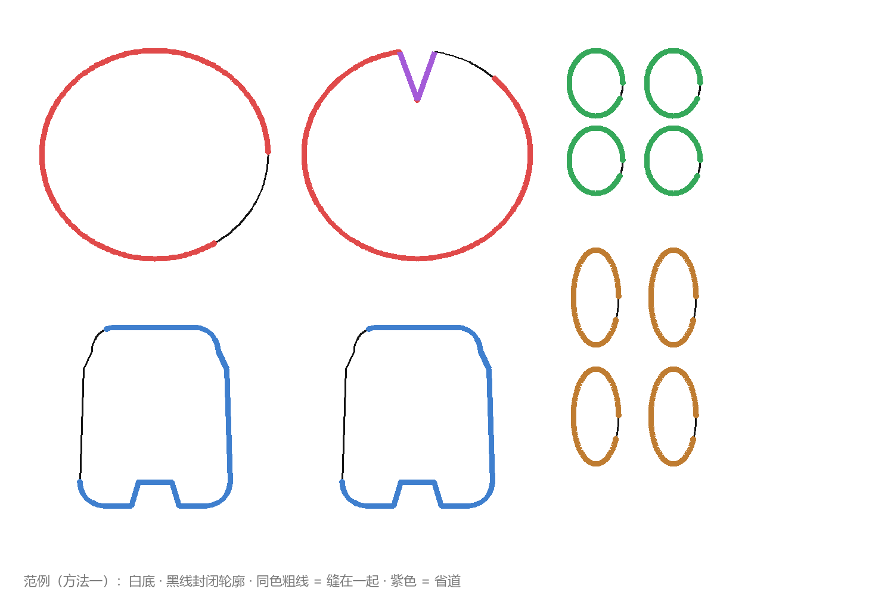
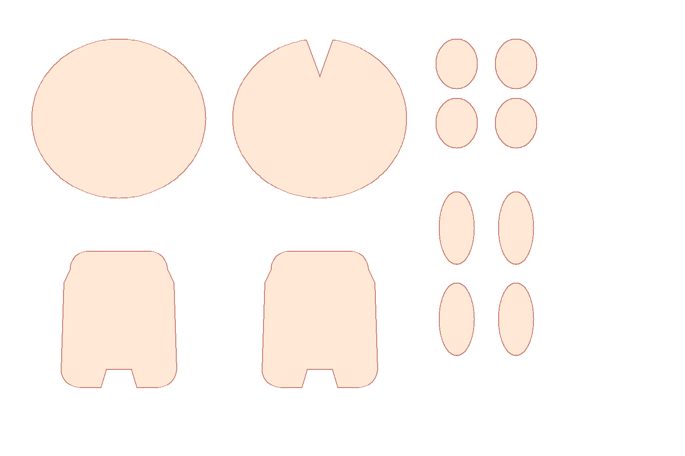
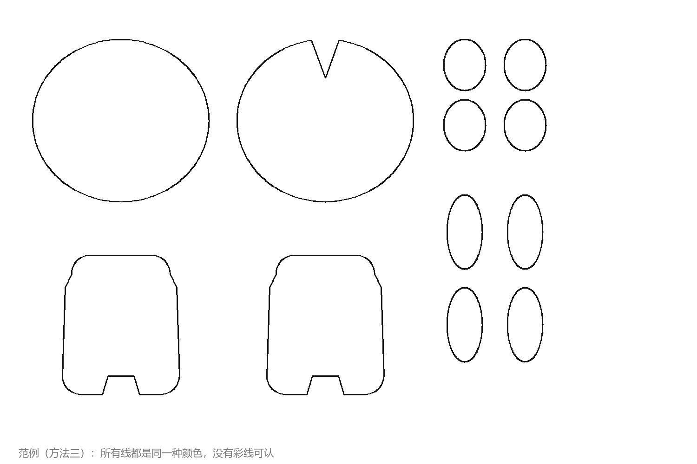

# 图纸上传说明书

> 入口：「制作娃娃」页最上面一行「🧍 体型」→「＋ 上传我的图纸」。三份范例图都在页面的说明书弹窗里能下载（也在 `public/games/nunu-studio/`）。

## 三种方法，按你手上的图纸选

| | 你的图纸长这样 | 缝合怎么来 | 范例图 |
|---|---|---|---|
| 方法一 | 白底，黑线轮廓，**要缝在一起的边涂成同一种颜色** | 同色 = 缝在一起，**直接缝合**，最准 | `sample-pattern.png` |
| 方法二 | **透明底**的填色图（已经抠好、一块一块的） | 算法按透明度扣出每一块 → **你定义每块是什么** → 按用途缝合 | `sample-transparent.png` |
| 方法三 | 所有线同一种颜色（全是黑线 / 红线），没有标记 | 算法先**自动猜**用途和缝合 → 猜得不对，**你逐片改用途** | `sample-mono.png` |

不管哪种，上传后都会弹出「🧩 核对每一片是什么」：左边是认出来的每一片（编号、按用途上色），右边每片一个下拉框。点一片、改它的用途，点「完成」。以后想再改，设计台最上面一行有「🧩 校对每片用途」。

## 方法一：彩线（最准）

一张图，白底。每片裁片用黑线画成**封闭轮廓**；要缝在一起的两条边，把那一段轮廓**涂成同一种颜色**；省道涂紫色。

这张图里：头（前后各一片，红线）、身体（前后各一片，蓝线）、四个耳朵（绿线）、四只手（橙线），头后片顶上有一个 V 形口（紫色 = 省道）。每一圈里留着一小段黑线，那是「返口 / 接头」，不缝。

### 规则
1. **图片**：PNG 或 JPG，扫描、手绘、软件导出都行。不需要比例尺（3D 里头多大，以「脸片」的宽度为准）。长边超过 1500 像素会自动缩小。
2. **裁片（黑线）**：白底，黑色或深色线，每一片画成封闭轮廓，线粗 2 像素以上。线有断口（缺 2 像素以上）这一片就认不出来。片和片之间留空 10 像素以上，别碰在一起。片里面不要画别的东西（纱向箭头、文字、尺寸标注）。里面包着的小框（比如脸里的眼睛框）不算裁片，但会帮算法认出「这是脸」。
3. **缝合（彩线）**：

| 颜色 | 色值 | 叫法 |
|---|---|---|
| 红 | `#e04a4a` | 红线 |
| 蓝 | `#3f7fce` | 蓝线 |
| 绿 | `#35a85a` | 绿线 |
| 橙 | `#bf7c31` | 橙线 |
| 粉 | `#e06aa0` | 粉线 |
| 青 | `#2fb6bd` | 青线 |
| 黄 | `#d9b319` | 黄线 |
| 紫 | `#a45bd8` | 省道（专用） |

   - **彩线就是轮廓本身**：把那一段轮廓描粗涂色（6–10 像素），不是在旁边另外画一条。离轮廓超过 18 像素的彩线会被当成没贴在轮廓上。
   - 一段彩线可以是直线、弧线，也可以是整整一圈。算法量的是这段彩线**贴着轮廓走过的弧长**。
   - 同一种颜色出现两次 = 一条缝（两段长度应该一样）。出现多于两次，按长度最接近的两两配。
   - 轮廓上**留黑线**的那一段 = 不缝（返口、开口、接头）。
4. **省道（紫色）**：画成轮廓上凹进去的一个 V 形口，V 的两条边都涂紫色。算法在 V 的尖上把它劈成两条腿，两条腿配成一条缝。
5. **前片和后片**：对折缝成袋子的，前后各画一份，周边用同一种颜色。

整张图的线只有一种颜色时（比如全是红线），那种颜色只是线的颜色、不是配对记号，算法会按方法三处理。

## 方法二：透明底的填色图

把每一块抠出来，放在透明底上，一块是一片。算法按「不透明的地方」扣出每一块，**但它不知道每一块是什么**，所以：

1. 上传后弹出「核对每一片是什么」，每一片已经有一个猜的用途；
2. 你把猜错的改掉（头、身体、耳朵、手臂、后脑、围条……）；
3. 点「完成」：缝合按用途的规矩算 —— 身体前↔身体后、左耳前↔左耳后、右耳前↔右耳后、左臂前↔左臂后、右臂前↔右臂后、脸↔后脑，周边缝在一起；轮廓上又尖又窄的 V 形口认作省道。

要求：每一块之间要分开（别连在一起）；块的颜色、纹理随便，不影响。面积太小的块（小于图面积的 1/3000）会被当成噪点丢掉。

## 方法三：单色线稿，自动猜

全是同一种颜色的线（比如全是黑线），**没有任何东西能告诉算法哪条边缝哪条边**。它只做有把握的事：

| 能做 | 怎么判断 |
|---|---|
| 认出每一片 | 封闭轮廓 |
| 认出脸 | 片里面包着 2 个以上的小框（眼睛、嘴） |
| 前片 + 后片 | 形状一模一样、不在中线两侧对称摆的两片 → 周边缝在一起（标「猜的」） |
| 省道 | 轮廓上又尖又窄的 V 形凹口（标「猜的」） |
| 圆头版式 | 脸 + 左右对称、自己不对称的两片大叶子 → 脸是球冠、叶子是后脑 |

它**不猜**：左右对称的两片缝哪几条边、小片是耳朵还是手臂（大小太像）、图里同时画了两种做法时你要哪一种。这些在「核对每一片是什么」里你自己选；想一步到位，就改用方法一上色。

### 用途怎么猜

| 看什么 | 猜成 |
|---|---|
| 缝在一起、面积相近的两片 | 一对（前 + 后） |
| 最大的两对里**更圆**的那一对 | 头（球豆体的头常比身体还大，所以不看谁大） |
| 最大的两对里另一对 | 身体 |
| 其余的对：细长的（短边 / 长边 < 0.5） | 手臂 |
| 其余的对：粗短的 | 耳朵 |
| 面积和身体差不多的对 | 另一种做法的身体，不猜，留给你选 |
| 偏左还是偏右 | 左 / 右（一边已经有了就给另一边） |

## 导入以后

- 下方有「缝合报告」：每一行是一条缝，两边各多长。**红字「差 x%」**：两边长度差超过 6%，缝起来会皱或拉不拢。「猜的」= 不是你标的。
- 「还有 N 段彩线没配上」：要么没贴在轮廓上，要么这种颜色只出现了一次。
- 选体型 / 上传 / 说明书 / 校对用途，都在「制作娃娃」页最上面一行。

## 常见问题

| 现象 | 原因 | 怎么办 |
|---|---|---|
| 提示「没认出裁片」 | 线没封闭，或不是透明底 / 白底 | 补断口；背景换白色或透明 |
| 少了一片 | 那片的线有断口，或和旁边的片连在了一起 | 补断口、拉开距离 |
| 彩线全没配上 | 彩线画在轮廓旁边、没在轮廓上 | 把轮廓本身涂成彩色 |
| 头和身体认反了 | 头不够圆 | 在「核对每一片」里改 |
| 3D 头身比例怪 | 头的大小以脸片宽度为准 | 检查脸片是不是认对了 |
| 同色的两段差了很多 | 两条边画得不一样长 | 看报告里的数字，改图 |

## 限制
- 一次只导入一张图；页面里最多保留最近 4 份导入的图纸。
- 只认颜色表里的 8 种颜色（颜色深浅有一点出入没关系）。
